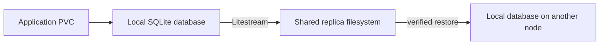

# kubernetes-sqlite-csi

[](https://github.com/Pukata/kubernetes-sqlite-csi/actions/workflows/ci.yml)
[](LICENSE)

**Let your SQLite app move between Kubernetes nodes.**

SQLite is a good fit for many small applications, but an ordinary local PVC
ties their data to one node. This experimental CSI driver keeps the working
database on local storage and streams a replica to a shared filesystem using
[Litestream](https://litestream.io/). Before a clean handover, it restores and
verifies the replica; the next node restores before exposing the volume.



> **Experimental storage software.** Keep independent backups. Replication is
> asynchronous, so writes that have not reached the replica can be lost after
> sudden failure. This project does not promise production availability.

## What it does

- Presents a normal `ReadWriteOncePod` PVC to one application instance.
- Keeps SQLite writes local; no application replication sidecar is required.
- Uses persistent ownership, epochs and API compare-and-swap to guard handover.
- Checks SQLite integrity and logical database contents before a clean release.
- Refuses takeover when a final sync or a required recovery check fails.
- Offers opt-in recovery through an independent, platform-neutral fencing API.

One database file belongs on each volume. Store attachments and other files in
separate application volumes. This is not a general filesystem replicator,
multi-writer SQLite cluster, or replacement for backups.

## Requirements

Use Linux Kubernetes nodes with local storage, privileged CSI node agents, and
a shared RWX replica PVC. The current application UID and GID are **1000**.
The backing filesystem must support the file operations Litestream requires;
test your storage backend before trusting it with data.

The provisioned capacity is descriptive: this driver does not partition disks,
enforce byte quotas or implement volume expansion. The Kubernetes integration
is exercised in CI on the versions listed in [the test guide](docs/testing.md).

## Install from source

There is no published release image or hosted chart repository yet. Build and
push an image to your own registry:

```sh
docker build -t your-registry/sqlite-csi:dev .
docker push your-registry/sqlite-csi:dev
kubectl create namespace sqlite-csi-system
```

Create an existing shared RWX claim named `sqlite-csi-replicas` in that
namespace, then install:

```sh
kubectl label node worker-a worker-b sqlite.csi/enabled=true
helm upgrade --install sqlite-csi ./charts/sqlite-csi \
  --namespace sqlite-csi-system \
  --set image=your-registry/sqlite-csi:dev \
  --set localPath=/mnt/ssd/sqlite-csi
```

Alternatively, set `createBackingClaim=true` and `backingStorageClass` to an
existing shared RWX storage class. The driver does not provision that backend.

Use `storageClassName: sqlite-csi`, `accessModes: [ReadWriteOncePod]`, one app
replica and the `Recreate` strategy. Mount the claim at `/data` and configure the
application to open `/data/database.db`. See [the example](examples/sqlite.yaml).

The default class requires a verified clean handover. An unreachable writer
stays locked. Opt-in `sqlite-csi-ha` recovery additionally requires confirmed
independent fencing and explicit acceptance of the latest-replica policy.
Read [failure recovery](docs/failure-recovery.md) before enabling it. The
Kubernetes control plane must also survive the failed node.

## Development and tests

```sh
make verify test build chart
make image e2e
```

CI runs formatting, static checks, Go race tests and coverage, Helm checks, and
disposable multi-node Kubernetes storage/recovery scenarios. It uses GitHub-hosted
runners and does not need access to an existing cluster or private infrastructure.
See [testing](docs/testing.md) and [contributing](CONTRIBUTING.md).

## Project status

The CSI identity is `sqlite.csi`. The interfaces and on-disk state are
pre-release and may change. Keep workloads on a pinned, tested revision and
validate restore and failover with disposable data before adopting an upgrade.

Licensed under [MIT](LICENSE). Litestream and the upstream Kubernetes CSI
sidecars retain their respective licenses. See [security](SECURITY.md) for
reporting and trust boundaries.
