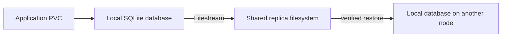

# csi-driver-sqlite

[](https://github.com/Pukata/csi-driver-sqlite/actions/workflows/ci.yml)
[](LICENSE)

**Let your self-hosted SQLite apps move between nodes in your Kubernetes homelab.**

You start with a few self-hosted apps. They use SQLite, so each app needs a
container, a data directory, and very little database administration. Then you
add a second machine and try Kubernetes: learning how Pods move, how to take a
node down for maintenance, and how services recover when something stops.

The application can move. Its database file is still on the first machine.

## The homelab problem

A local PersistentVolume has node affinity: Kubernetes schedules the app where
that disk exists. Adding another node does not replicate the database or make
the PVC portable. A node outage can leave the app waiting for its original
storage. See [Kubernetes local volumes](https://kubernetes.io/docs/concepts/storage/volumes/#local).

Putting the live database on a network share is not a universal shortcut.
SQLite has filesystem locking and durability requirements, and its WAL mode
requires processes accessing the database to share a host. See SQLite's
[network filesystem caveats](https://sqlite.org/useovernet.html) and
[WAL documentation](https://sqlite.org/wal.html). Running more app replicas also
does not create independent, coordinated copies of its database.

For a homelabber learning Kubernetes, the goal is modest: keep the app's simple
SQLite setup and local-disk writes, but let its single instance follow its Pod
to another node. You should be able to reason about where the data is and what
recovery can preserve.

## How this driver helps

This experimental CSI driver keeps the working database on local storage and
streams a replica to a shared filesystem using [Litestream](https://litestream.io/).
Before a clean handover, it restores and verifies the replica; the next node
restores before exposing the volume. The app continues using a normal PVC and
its usual SQLite path.



> **Experimental storage software.** Keep independent backups. Replication is
> asynchronous, so writes that have not reached the replica can be lost after
> sudden failure. This project does not promise production availability.

## One app replica, by design

This is for the common homelab setup: one instance of each self-hosted SQLite
app. Extra Kubernetes nodes let you move that instance for maintenance or
recovery; they do not turn it into several concurrent app instances.

Run **one application replica per database volume**, with `ReadWriteOncePod`
and the `Recreate` strategy. The volume permits one active Pod. Each separate
app can have its own PVC and move independently. The design provides storage
mobility and controlled recovery, rather than horizontal scaling of a SQLite app.

## What it does

- Presents a normal `ReadWriteOncePod` PVC to one application instance.
- Keeps SQLite writes local; no application replication sidecar is required.
- Uses persistent ownership, epochs and API compare-and-swap to guard handover.
- Checks SQLite integrity and logical database contents before a clean release.
- Refuses takeover when a final sync or a required recovery check fails.
- Offers opt-in recovery through an independent, platform-neutral fencing API.

One database file belongs on each volume. Store attachments and other files in
separate application volumes. This is not a general filesystem replicator,
multi-writer SQLite cluster, or replacement for backups.

## Requirements

Use Linux Kubernetes nodes with local storage, privileged CSI node agents, and
a shared RWX replica PVC. The current application UID and GID are **1000**.
The backing filesystem must support the file operations Litestream requires;
test your storage backend before trusting it with data.

The provisioned capacity is descriptive: this driver does not partition disks,
enforce byte quotas or implement volume expansion. The Kubernetes integration
is exercised in CI on the versions listed in [the test guide](docs/testing.md).

## Install from source

There is no published release image or hosted chart repository yet. Build and
push an image to your own registry:

```sh
docker build -t your-registry/sqlite-csi:dev .
docker push your-registry/sqlite-csi:dev
kubectl create namespace sqlite-csi-system
```

Create an existing shared RWX claim named `sqlite-csi-replicas` in that
namespace, then install:

```sh
kubectl label node worker-a worker-b sqlite.csi/enabled=true
helm upgrade --install sqlite-csi ./charts/sqlite-csi \
  --namespace sqlite-csi-system \
  --set image=your-registry/sqlite-csi:dev \
  --set localPath=/mnt/ssd/sqlite-csi
```

Alternatively, set `createBackingClaim=true` and `backingStorageClass` to an
existing shared RWX storage class. The driver does not provision that backend.

Use `storageClassName: sqlite-csi`, `accessModes: [ReadWriteOncePod]`, one app
replica and the `Recreate` strategy. Mount the claim at `/data` and configure the
application to open `/data/database.db`. See [the example](examples/sqlite.yaml).

The default class requires a verified clean handover. An unreachable writer
stays locked. Opt-in `sqlite-csi-ha` recovery additionally requires confirmed
independent fencing and explicit acceptance of the latest-replica policy.
Read [failure recovery](docs/failure-recovery.md) before enabling it. The
Kubernetes control plane must also survive the failed node.

## Common questions

### Why is my SQLite Pod tied to one node?

A normal local PersistentVolume has node affinity. Kubernetes schedules its
consumer on that node. This driver provisions a logical volume without node
affinity and prepares a separate local working directory on the selected node.

### How does the database move?

During a clean handover, the driver verifies the final shared replica before
releasing the old writer. The replacement restores that replica into its own
local storage before the PVC is mounted. The application continues using its
usual SQLite path. Attachments belong on a separate application volume.

### What if the old node suddenly fails?

The default class keeps ownership locked. Opt-in automatic recovery requires
an independent fence that confirms the old machine is stopped and cannot
restart. It then restores the latest valid replica; unpublished writes can be
lost. The Kubernetes control plane and replica backend must still be available.

## Development and tests

```sh
make verify test build chart
make image e2e
```

CI runs formatting, static checks, Go race tests and coverage, Helm checks, and
disposable multi-node Kubernetes storage/recovery scenarios. It uses GitHub-hosted
runners and does not need access to an existing cluster or private infrastructure.
See [testing](docs/testing.md) and [contributing](CONTRIBUTING.md).

## Project status

The CSI identity is `sqlite.csi`. The interfaces and on-disk state are
pre-release and may change. Keep workloads on a pinned, tested revision and
validate restore and failover with disposable data before adopting an upgrade.

Licensed under [MIT](LICENSE). Litestream and the upstream Kubernetes CSI
sidecars retain their respective licenses. See [security](SECURITY.md) for
reporting and trust boundaries.
