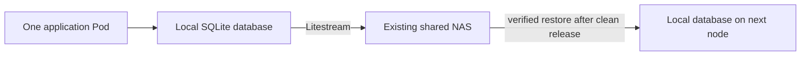

# csi-driver-sqlite

[](https://github.com/Pukata/csi-driver-sqlite/actions/workflows/ci.yml)
[](LICENSE)

**Let your self-hosted SQLite apps move between nodes in your Kubernetes homelab.**

You start with a few self-hosted apps. SQLite keeps them easy to run: one app
instance, a database file, and no separate database service to maintain. Then
you add another machine and start learning Kubernetes.

Now you want to reboot a worker for maintenance. Kubernetes can start the app
on another node, but a local PVC keeps its database tied to the original machine.

`csi-driver-sqlite` gives that single app instance a database PVC that can move
with it. Keep local-disk SQLite writes, use the NAS you already own for replicas,
and practise moving your apps without copying database files by hand. Your app
keeps its normal SQLite path; replication runs in the driver.

The app writes to local disk. [Litestream](https://litestream.io/) streams a
replica to your existing NAS. For a planned move, Kubernetes stops the old Pod,
the driver verifies the final replica, and the next node restores it before
starting the app.

**Node-loss recovery is manual.** An unreachable node keeps ownership; a
replacement waits rather than starting a second writer. Replication is
asynchronous, so sudden failure can lose recent writes. Keep independent backups.



## What you need

- Linux **amd64** Kubernetes nodes with local working storage.
- An existing shared **RWX StorageClass** for the NAS replicas. Your NFS/SMB
  provisioner supplies the mount; this driver does not provision the NAS.
  The replica mount must be writable by UID/GID 1000.
- One app replica, `ReadWriteOncePod`, the `Recreate` strategy, and app
  **UID/GID 1000**. The Gatus example below already sets these.
- Permission to install privileged CSI node agents.
- One SQLite database per PVC. Put attachments and other files on separate volumes.

Kubernetes 1.35.8 and 1.36.4 are exercised in CI. Start with disposable data:
this is an **experimental alpha**, and its state format can change.

## Quickstart: Gatus on a movable SQLite PVC

Install [v0.2.0-alpha.2](https://github.com/Pukata/csi-driver-sqlite/releases/tag/v0.2.0-alpha.2).
Replace the worker names and `YOUR_SHARED_RWX_CLASS` with your own:

```sh
kubectl create namespace sqlite-csi-system
kubectl label namespace sqlite-csi-system pod-security.kubernetes.io/enforce=privileged
kubectl label node worker-a worker-b sqlite.csi/enabled=true

helm upgrade --install sqlite-csi oci://ghcr.io/pukata/charts/sqlite-csi \
  --version 0.2.0-alpha.2 --namespace sqlite-csi-system \
  --set createBackingClaim=true \
  --set backingStorageClass=YOUR_SHARED_RWX_CLASS \
  --set localPath=/var/lib/sqlite-csi-data \
  --wait --timeout 5m

kubectl create namespace sqlite-demo
kubectl apply -n sqlite-demo -f https://raw.githubusercontent.com/Pukata/csi-driver-sqlite/v0.2.0-alpha.2/examples/gatus.yaml
kubectl rollout status -n sqlite-demo deployment/gatus
kubectl port-forward -n sqlite-demo service/gatus 8080:8080
```

Open <http://localhost:8080>. Gatus stores its monitoring history in the SQLite
PVC. See the [Gatus walkthrough](docs/gatus.md) for the storage layout and the
movement checks used in CI.

Already have a shared RWX PVC? Create it in `sqlite-csi-system`, omit
`createBackingClaim` and `backingStorageClass`, and set `backingClaim` to its name.
See [release installation](docs/releases.md) for checksums and private-registry access.

## What happens when something fails?

- **App container exits:** Kubernetes restarts it; the database stays local.
- **Planned node move:** the old Pod stops, the replica is verified, and the next
  node restores it. Expect downtime for verification, restore and app startup.
- **NAS unavailable or verification fails:** the move waits. Restore NAS access
  and let Kubernetes retry.
- **Node lost:** ownership stays locked. Follow the
  [manual recovery guidance](docs/failure-recovery.md).

Requested PVC capacity is descriptive; the driver does not enforce disk quotas
or support expansion, cloning or snapshots. It replicates the configured
database, not an entire application directory or several databases atomically.

## More examples and details

- [Homebox: separate database and attachment volumes](docs/homebox.md).
- [Independent backups](docs/independent-backup.md).
- [What the tests cover](docs/testing.md) and [recorded results](docs/results/README.md).
- [Other storage approaches](docs/alternatives.md).
- [Building and contributing](CONTRIBUTING.md).

Existing alpha.1 automatic-recovery volumes need
[migration before upgrading](docs/failure-recovery.md#upgrading-legacy-automatic-recovery-volumes).
The CSI identity is `sqlite.csi`. Licensed under [MIT](LICENSE);
see [security](SECURITY.md) for reporting.
